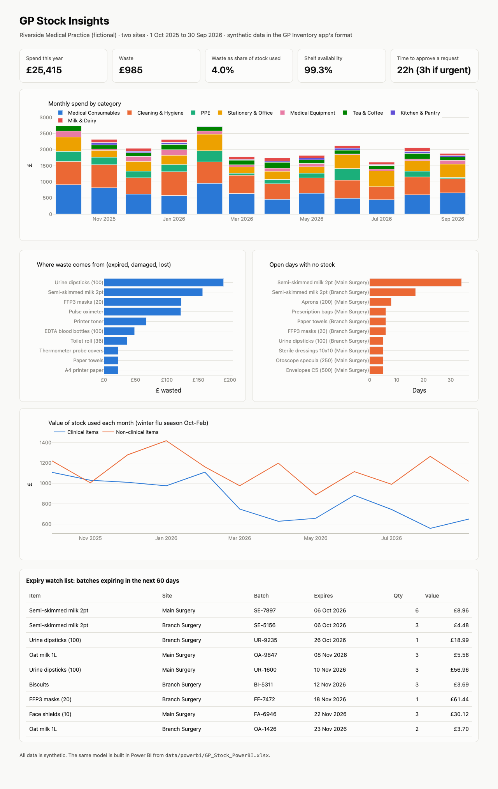

# GP Stock Insights

A year of stock data from a two-site GP practice, turned into a Power BI-ready
star schema and a dashboard that answers the questions a practice manager
actually asks: **What are we spending? What are we wasting? What keeps running
out? What is about to expire?**

It is the analytics side of the [GP Inventory app](#background), a stock and
workflow system I built that is in daily use at a GP practice. To keep real
practice data private, this repo uses **synthetic data in exactly the app's
format** (same tables, fields and rules) for a fictional practice.

**[Open the dashboard preview](docs/index.html)** · Power BI build guide: [powerbi/README.md](powerbi/README.md)



## What it shows (on the synthetic year)

| | |
|---|---|
| Spend on stock | £25,415 |
| Waste (expired, damaged, lost) | £985, 4.0% of the value of stock used |
| Biggest sources of waste | slow-moving clinical items (urine dipsticks, FFP3 masks) and milk |
| Shelf availability | 99.3% of item-days on open days |
| What runs out most | milk: the classic trade-off between running out and throwing it away |
| Time to approve a request | 22 hours on average, 3 hours when marked urgent |
| Winter effect | clinical items are used more during the October-February flu season |

## How it works

```
GP Inventory app export ──► DuckDB SQL star schema ──► checks ──► Power BI (Excel import) + HTML preview
 sites, categories, items,      dim_date, dim_site,        stock reconciles      DAX measure library,
 site stock, movements,         dim_item, dim_staff,       to the app, batches   3-page report guide
 batches, requests, users       fact_movement,             add up, transfers
                                fact_daily_stock,          balance
                                fact_request, fact_batch
```

- **`gpstock/generate.py`** simulates the year day by day with the app's own rules: stock is used earliest-expiry-first, expired stock is never used and is disposed of at the weekly check, low stock triggers a request that a manager approves before the delivery arrives as a new batch, and a site that runs out can borrow from the other site.
- **`gpstock/sql/model.sql`** builds the star schema. The key table, `fact_daily_stock`, rebuilds closing stock for every item, at every site, on every day as a running total of its movements (a window function over a date spine). That is what makes "days out of stock" and "days below reorder level" possible, which the app itself does not store.
- **`gpstock/build.py`** runs five data checks before anything is exported. The most important one: the stock rebuilt from a year of movements must equal the app's current stock, item by item.
- **`powerbi/`** has the DAX measures (spend, waste %, availability %, stockout days, approval time, value expiring) and a step-by-step guide to build the report in the browser.

## Run it

```bash
python -m venv .venv && source .venv/bin/activate
pip install -r requirements.txt
python -m gpstock.build --generate   # synthetic year → star schema → checks → data/powerbi/GP_Stock_PowerBI.xlsx
python -m gpstock.report             # docs/index.html
pytest
```

## Background

The GP Inventory app (React, Node.js, MongoDB) replaced the Excel sheets a GP
practice used for stock, requests and staff timesheets. It covers two sites,
low-stock email alerts, batch and expiry tracking, AI receipt reading (Google
Gemini), request approvals, role-based permissions, and Excel/PDF reports. This
project is the next step: turning the data it collects into decisions.

---
Built by Mahum Maqbool · [github.com/mahum24](https://github.com/mahum24) · all data in this repo is synthetic
